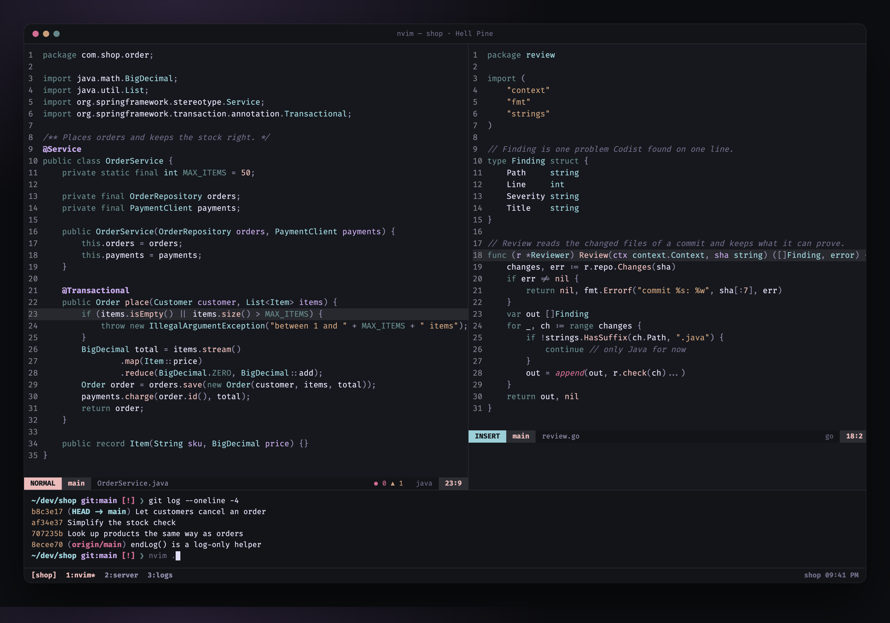
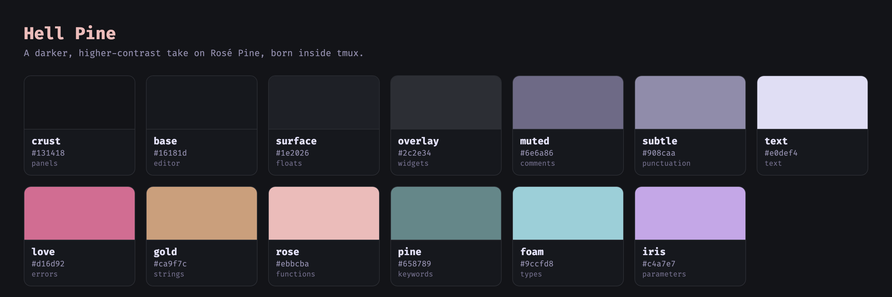

# Hell Pine for Neovim

A darker, higher-contrast take on [Rosé Pine](https://rosepinetheme.com/), born inside tmux. This is the Neovim
port of the [Hell Pine VS Code theme](https://github.com/abxengg/hell-pine): the same colours, the same choices
(keywords pine, types foam, functions rose, strings gold, parameters iris, errors love, comments muted and italic),
and the same language-server colours.

Matching themes for your terminal and tools live in their own repositories, all made from this one palette: see
[Other ports](#other-ports).





## Install

[lazy.nvim](https://github.com/folke/lazy.nvim):

```lua
{
    "abxengg/hell-pine.nvim",
    lazy = false,
    priority = 1000,
    config = function()
        require("hell-pine").setup({ transparent = false })
        vim.cmd.colorscheme("hell-pine")
    end,
}
```

Any other plugin manager works too: put the repository on the runtime path and run `:colorscheme hell-pine`.

## Options

```lua
require("hell-pine").setup({
    transparent = false,  -- leave the background to the terminal (for a translucent window)
    italic = true,        -- comments, library functions, quotes
    bold = true,          -- annotations, headings, the mode in the status line
    dim_inactive = false, -- darken windows without the cursor
    styles = {            -- per kind: comments, keywords, functions, strings, types, variables
        comments = { italic = true },
    },
    on_highlights = function(hl, c) -- change any group; c is the palette
        hl.CursorLineNr = { fg = c.rose, bold = true }
    end,
})
```

The palette is `require("hell-pine").palette()`.

## Status line

[lualine](https://github.com/nvim-lualine/lualine.nvim): `require("lualine").setup({ options = { theme = "hell-pine" } })`.

## Supported

Tree-sitter, language-server semantic tokens, diagnostics, and the plugins people use most: gitsigns, telescope,
which-key, lazy, mason, indent-blankline, nvim-tree, neo-tree, flash, fidget, noice, blink.cmp, nvim-cmp, mini,
trouble and nvim-dap. The terminal inside Neovim gets the same sixteen colours.

## Other ports

| Tool | Repository |
|---|---|
| VS Code | [abxengg/hell-pine](https://github.com/abxengg/hell-pine) |
| Ghostty | [abxengg/hell-pine-ghostty](https://github.com/abxengg/hell-pine-ghostty) |
| WezTerm | [abxengg/hell-pine-wezterm](https://github.com/abxengg/hell-pine-wezterm) |
| kitty | [abxengg/hell-pine-kitty](https://github.com/abxengg/hell-pine-kitty) |
| Alacritty | [abxengg/hell-pine-alacritty](https://github.com/abxengg/hell-pine-alacritty) |
| tmux | [abxengg/hell-pine-tmux](https://github.com/abxengg/hell-pine-tmux) |
| Starship | [abxengg/hell-pine-starship](https://github.com/abxengg/hell-pine-starship) |
| btop | [abxengg/hell-pine-btop](https://github.com/abxengg/hell-pine-btop) |
| fish | [abxengg/hell-pine-fish](https://github.com/abxengg/hell-pine-fish) |
| Zed | [abxengg/hell-pine-zed](https://github.com/abxengg/hell-pine-zed) |
| fzf | [abxengg/hell-pine-fzf](https://github.com/abxengg/hell-pine-fzf) |

Each has its own install steps. They are all made from `lua/hell-pine/palette.lua` by `scripts/extras.py`, which
writes into clones of those repositories sitting next to this one:

```sh
for t in ghostty wezterm kitty alacritty tmux starship btop fish zed fzf; do gh repo clone abxengg/hell-pine-$t ../hell-pine-$t; done
python3 scripts/extras.py
```

## Development

`nvim --headless -u NONE -l tests/smoke.lua` loads the theme and checks its main colours against the VS Code
theme. CI runs it on every push, and checks that every port repository matches the palette.

## Licence

MIT, like the VS Code theme.
